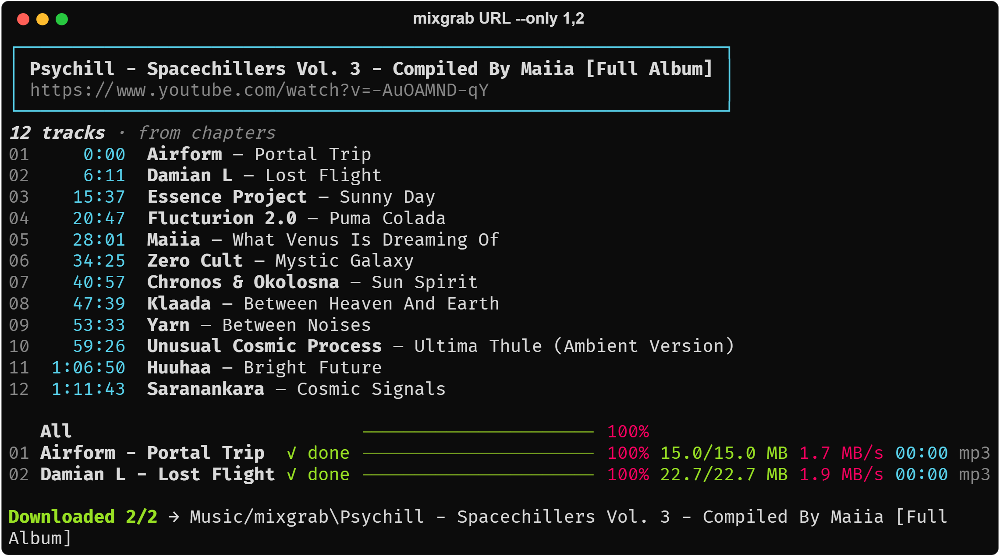
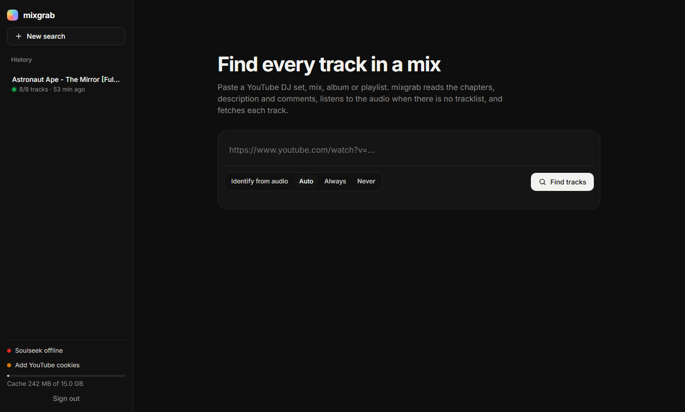
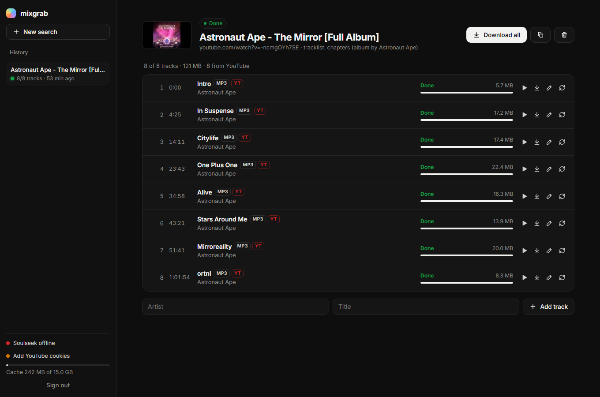

# mixgrab

Paste a YouTube DJ set, mix, album or playlist. mixgrab finds the tracklist and downloads every track.

- **Finding the tracklist**: mixgrab reads the video's chapters, description and comments, then checks MixesDB and MusicBrainz. If there's still no tracklist, it identifies the songs from the audio.
- **Downloading**: each track comes from Soulseek. If a track isn't there, mixgrab takes it from YouTube instead and marks the file `[YT]`.
- **MP3 copies**: lossless files (FLAC, WAV and similar) also get an MP3 copy saved next to them.



mixgrab comes as a **console app**, `mixgrab`, for Windows, macOS and Linux. There is also an optional **private web app**, `mixgrab-web`, with one owner login. Both run on the same engine.

## Install

### Windows
1. Download **`mixgrab-windows-x64.zip`** from the [latest release](https://github.com/avtii/mixgrab/releases/latest) and unzip it, for example to `C:\Tools\mixgrab`.
2. Install the two helpers it needs: ffmpeg (for audio) and Deno (YouTube needs a JavaScript runtime):
   ```powershell
   winget install Gyan.FFmpeg
   winget install DenoLand.Deno
   ```
3. Optional: add the folder to your PATH, so `mixgrab` works from any terminal:
   ```powershell
   [Environment]::SetEnvironmentVariable("Path", $env:Path + ";C:\Tools\mixgrab", "User")
   ```
4. Open a new terminal and run `mixgrab --check`.

The executable isn't code-signed. If Windows SmartScreen warns you, click **More info → Run anyway**.

### macOS
1. Download from the [latest release](https://github.com/avtii/mixgrab/releases/latest):
   - **`mixgrab-macos-arm64.tar.gz`** for Apple Silicon (M1 or later);
   - **`mixgrab-macos-x64.tar.gz`** for Intel Macs.
2. Unpack the file, let macOS run the unsigned binary, and move it onto your PATH:
   ```bash
   cd ~/Downloads
   tar -xzf mixgrab-macos-*.tar.gz
   xattr -d com.apple.quarantine mixgrab
   sudo mv mixgrab /usr/local/bin/
   ```
3. Install the helpers with [Homebrew](https://brew.sh): `brew install ffmpeg deno`
4. Run `mixgrab --check`.

### From source (any OS, Python 3.11+)
```bash
pipx install "git+https://github.com/avtii/mixgrab"
# or: git clone https://github.com/avtii/mixgrab && cd mixgrab && pip install -e .
```
You still need ffmpeg and Deno (or Node.js) on your PATH.

### Check the setup
```
> mixgrab --check
mixgrab 0.3.0 on Windows AMD64
config:   C:\Users\you\.mixgrab\config.toml (exists)
ffmpeg:   C:\...\ffmpeg.exe
JS:       C:\...\deno.exe
cookies:  none (only needed if YouTube asks you to sign in)
download: C:/Users/you/Music/mixgrab
soulseek: mixgrab_1a2b3c
ready
```

## Use
```
mixgrab "https://www.youtube.com/watch?v=-AuOAMND-qY"   # find tracklist + download everything
mixgrab URL --dry-run                                   # just show the tracklist
mixgrab URL --only 3,7                                  # download only some tracks
mixgrab URL --identify                                  # always identify songs from the audio
mixgrab URL --tracklist my_list.txt                     # your own "Artist - Title" lines
mixgrab URL --no-youtube                                # Soulseek only, no [YT] fallback
mixgrab URL --no-mp3                                    # keep FLAC/WAV only, no MP3 copies
mixgrab URL --out D:\Music                              # download somewhere else this time
```

On the first run, mixgrab creates `~/.mixgrab/config.toml`. It contains your download folder (default `~/Music/mixgrab`) and a new, random Soulseek account just for mixgrab. That account is separate from SoulseekQt, so both can be online at the same time.

Each mix goes into its own folder: `<download_dir>/<mix title>/`. The folder contains:
- `NN - Artist - Title.flac` plus `NN - Artist - Title.mp3`;
- `NN - Artist - Title [YT].mp3`, for tracks that came from YouTube;
- `tracklist.txt`, `playlist.m3u` and `missing.txt`.

If you run the same URL again, mixgrab skips the tracks it already has.

### If YouTube asks you to sign in
Sometimes YouTube refuses with "Sign in to confirm you're not a bot". This mostly happens on VPNs and servers. Give mixgrab your YouTube cookies once:
```
mixgrab --cookies cookies.txt URL                # saved to ~/.mixgrab/youtube-cookies.txt and reused
mixgrab --cookies-from-browser firefox URL       # or read them live from a browser
```
To make `cookies.txt`:
1. Sign in to youtube.com in a private window.
2. Export the cookies with a "cookies.txt" browser extension, such as *Get cookies.txt LOCALLY*.
3. Close the private window.

Recent Chrome versions on Windows encrypt their cookies, so `--cookies-from-browser` works best with Firefox. On Windows with Chrome, use the file instead.

## How the tracklist is found
1. **Playlist URL**: each video title becomes a track.
2. **The video itself**: mixgrab checks, in order:
   - the chapters;
   - the description;
   - the comments: the uploader's or pinned comment first, then the comment with the most tracks.

   Chapters that only give a song title (as album uploads often do) take the artist from the video.
3. **Online lookup**, when the list is missing or looks incomplete:
   - **MixesDB**: searched by video ID, then by title words. A page that links to the video counts as verified.
   - **MusicBrainz**, for albums: it picks the release whose total length is closest to the video's.
4. **Audio identification**, when there are still gaps:
   - mixgrab downloads the mix audio and cuts a 12-second clip every 45 seconds;
   - each clip goes to Shazam, then to ACRCloud and AudD if you've added their keys to the config;
   - a song counts only if at least 2 clips match it. Songs heard only once are listed but not downloaded.

## How tracks are downloaded
1. **Soulseek**. Results are scored on:
   - artist and title match;
   - unwanted versions (remix, live, edit);
   - format: FLAC is preferred over MP3 320, and MP3 under 192 kbps is rejected;
   - duration;
   - the peer's free slots and speed.

   mixgrab tries up to 6 peers. It drops a peer whose queue doesn't move or whose transfer stalls.
2. **YouTube fallback**. mixgrab prefers "Artist - Topic" channels and "official audio" uploads, and rejects mixes, live versions and covers. The file is saved as MP3 with `[YT]` in its name.
3. **MP3 copy**. Each lossless file gets a 320 kbps MP3 copy next to it, with the tags kept.

## Config
These sections in `~/.mixgrab/config.toml` are optional:
```toml
[convert]
mp3 = true                  # MP3 copy of lossless files
bitrate = 320

[youtube]
fallback = true
quality = "0"               # LAME VBR 0 (best) .. 9, or a bitrate like "320"
cookies = "~/cookies.txt"   # or run once with --cookies FILE
# cookies_from_browser = "firefox"

[identify]
audd_token = ""             # https://audd.io
[identify.acrcloud]         # https://www.acrcloud.com (good for DJ sets)
host = "identify-eu-west-1.acrcloud.com"
access_key = ""
access_secret = ""
```

## Web app (private, single owner)
| New search | A finished job |
|---|---|
|  |  |

The web app does the same job in a browser. Features:
- job history and live progress;
- per-track play, download, edit and retry;
- a zip of the whole job;
- download links that expire;
- a cache that cleans itself.

It has exactly one login, which you set with environment variables. There is no sign-up.

```bash
pip install ".[web]"
MIXGRAB_PASSWORD='a-long-password' mixgrab-web      # http://localhost:8080
```

The web app and the CLI share `mixgrab/engine.py`. Soulseek allows one session per account, so the web app keeps a single Soulseek connection and runs every job through it.

If the server is in a data center, YouTube will usually ask for a sign-in. Use **Add YouTube cookies** in the sidebar to upload a `cookies.txt`, then press **Resume** on the failed job.

| Variable | Default | Meaning |
|---|---|---|
| `MIXGRAB_PASSWORD` | (required, 12+ characters) | owner password |
| `MIXGRAB_USER` | `owner` | owner login |
| `MIXGRAB_DATA` | `./data` (`/data` in Docker) | jobs, files, cache, uploaded cookies |
| `SLSK_USERNAME` / `SLSK_PASSWORD` | generated and saved | Soulseek account |
| `SLSK_PORT` | 61234 | Soulseek listen port (publish it and port +1) |
| `CACHE_MAX_GB` / `CACHE_HIGH` / `CACHE_FREE` | 15 / 0.92 / 0.12 | at 92% of the budget, the oldest 12% is deleted |
| `LINK_TTL_MIN` | 1440 | how long a file link stays valid |
| `CONVERT_MP3` / `MP3_BITRATE` | 1 / 320 | MP3 copies |
| `YOUTUBE_FALLBACK` / `YOUTUBE_QUALITY` | 1 / 0 | YouTube fallback |
| `YTDLP_COOKIES` | (none) | fixed cookies.txt path, instead of uploading one |
| `AUDD_TOKEN`, `ACR_HOST`, `ACR_ACCESS_KEY`, `ACR_ACCESS_SECRET` | (none) | extra audio recognizers |

### Docker and deploy
The `Dockerfile` builds the web app with ffmpeg and Deno included.

`.github/workflows/deploy.yml` runs on every push to `main`:
1. It builds `ghcr.io/<owner>/mixgrab`.
2. If deploy secrets are set, it connects to your server over SSH, writes `/opt/mixgrab/compose.yml` and `.env`, and restarts the container. Lines in `/opt/mixgrab/extra.env` are added to `.env`.
3. It adds the site to a Caddy reverse proxy.

Deploy settings:
- Required secrets: `DEPLOY_KEY` and `MIXGRAB_PASSWORD`.
- Required variables: `DEPLOY_HOST` and `DEPLOY_USER`.
- Optional: `DEPLOY_PORT`, `DEPLOY_PASSPHRASE`, `AUDD_TOKEN`, `ACR_*` and `MIXGRAB_DOMAIN`.

### Building the executables
`.github/workflows/release.yml` builds the single-file executables with PyInstaller (`packaging/mixgrab.spec`) on Windows and macOS (Apple Silicon and Intel). Pushing a `v*` tag publishes them as a GitHub Release.

To build locally:
```bash
pip install . "yt-dlp[default]" pyinstaller
cd packaging && pyinstaller --noconfirm --distpath ../dist --workpath ../build mixgrab.spec
```
